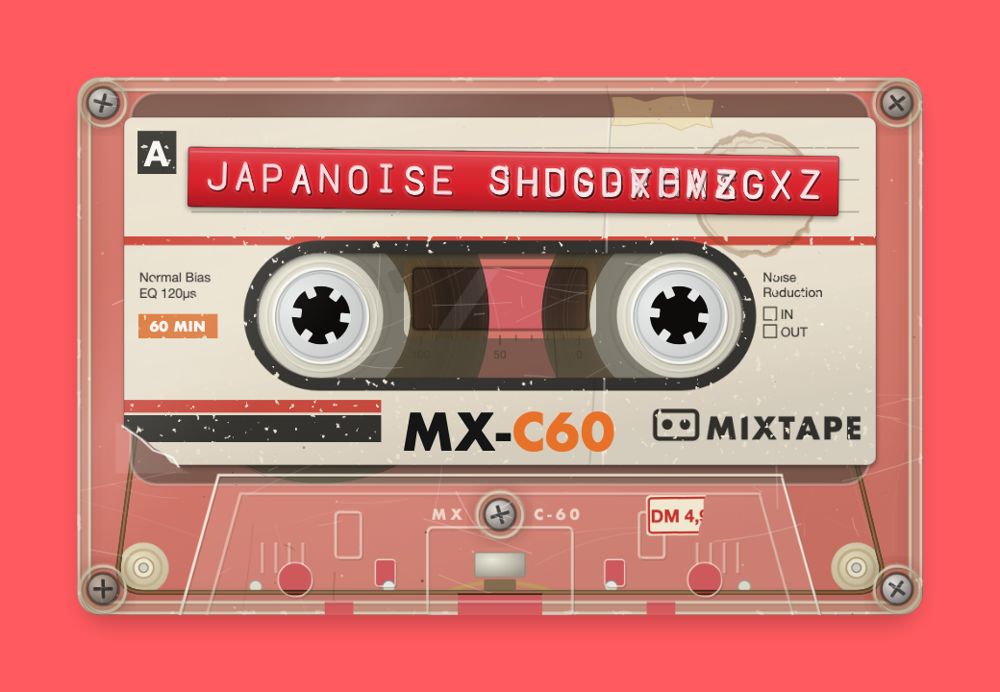
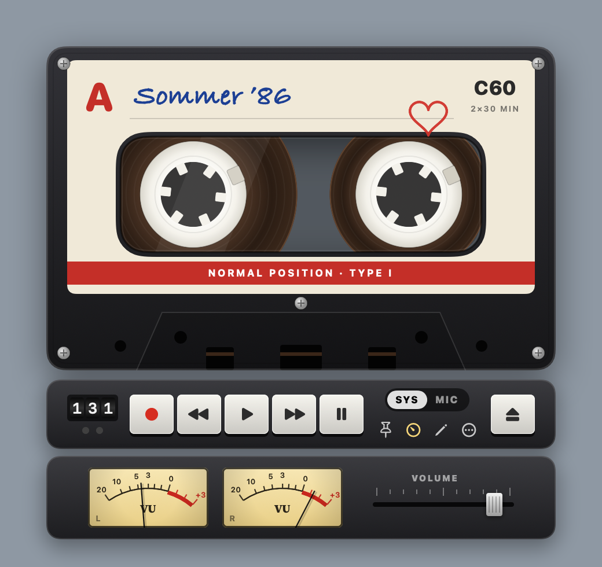
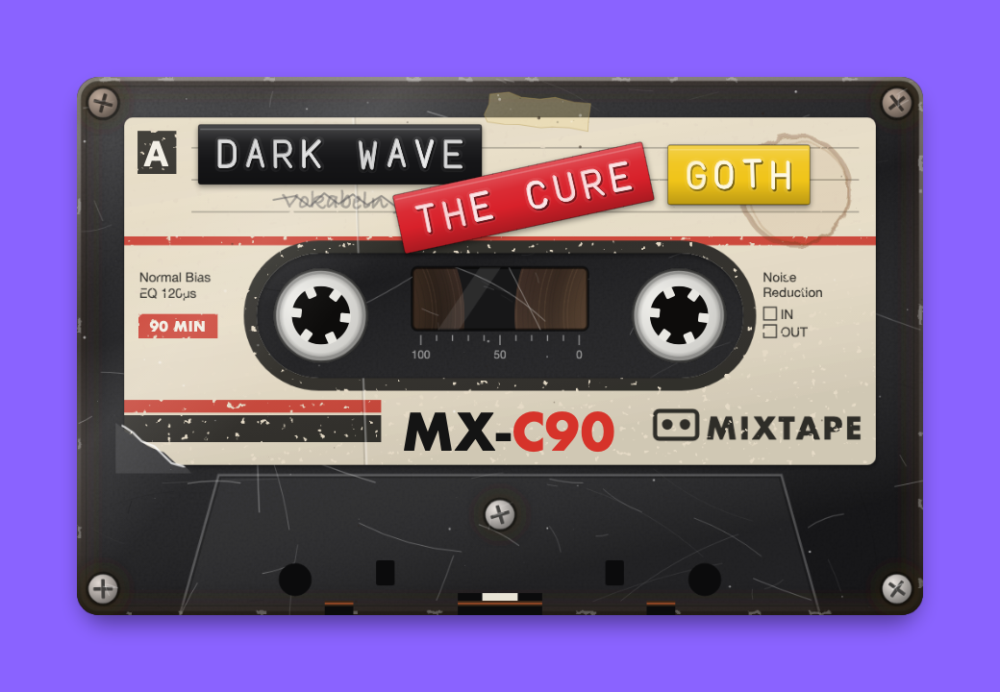
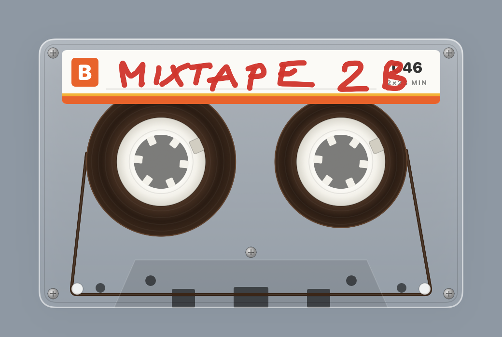
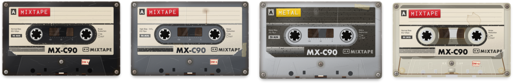
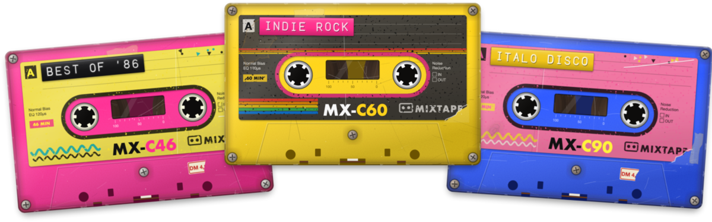
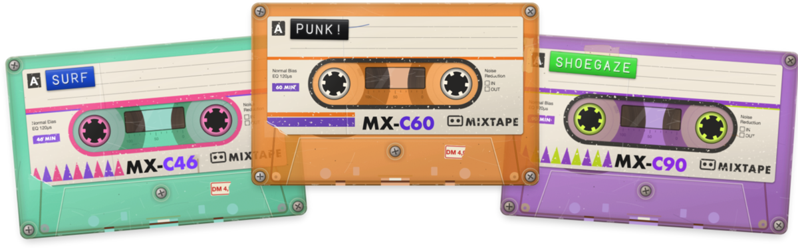
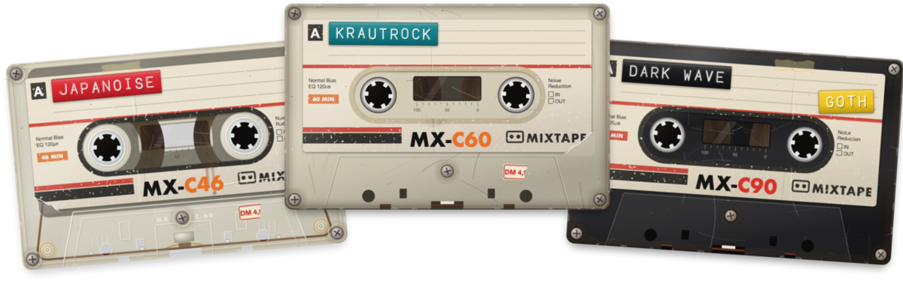

<p align="center"></p>

<h1 align="center">Mixtape App</h1>

<p align="center"><b>The perfect simulation of an audio cassette for your Mac – just like in 1986.</b></p>

<p align="center"><a href="https://mixtape.toyko.online">mixtape.toyko.online</a></p>

It’s the simulation of a cheap tape recorder, not a high-end audiophile component. A cassette on your Mac desktop. Tape whatever your Mac is playing – a song on Spotify, a clip on YouTube, an Instagram reel (if you REALLY have to) – or your own voice introducing the next song. Flip it over, punch the title onto label tape, and send it to a friend. They don’t even need the app: one tap on the link and the tape plays – on a phone it fills the whole screen.

Recording is fiddly, just like back then in 1986. There’s no shortcut: you can’t just drop in a playlist and hit send. You record in real time, listening to every song as it goes onto the tape. You hit PAUSE at just the right moment – the pause key squeaks a little, and the cut is never quite perfect. It takes time, it’s a pain in the …, but it’s actually fun. That’s exactly the feeling. And you make the effort, because it’s for that one special friend.

<p align="center">
<b><a href="../../releases/latest/download/Mixtape.dmg">⬇ Download Mixtape.dmg</a></b> &nbsp;·&nbsp; macOS 14.4 or later · Apple silicon & Intel
</p>

---

## The story behind it

I’m old enough to have done this for real. In 1986, where I grew up – in the south of Germany near the Czech border (it was the Czechoslovak border back then, just to be exact) – our local record store only had country music. Swapping tapes with friends at school (and after) was the only way to hear anything new. We put real effort into every mixtape, because we made them for each other. To be honest, I wouldn’t have known about The Cramps or The Vaselines without them. A good tape was a sign of friendship.

Tapes stayed with me. In Berlin in the 90s, cassettes were still the medium of the underground – demos, mixtapes and live recordings, passed from hand to hand.

That’s the feeling Mixtape App brings back – into the digital age. You’re not recording for yourself. You’re recording for your friends.

**Make the perfect mixtape. Share it with friends.**

## What it does

- **Just a cassette.** No window, no Dock icon – only the tape floats on your desktop. Hover over it and the deck appears.
- **Records what your Mac plays** – Spotify, YouTube, anything – or the microphone. Switch between SYS and MIC while recording.
- **Like real tape:** recording overwrites what was there, each side holds half the running time (C46, C60, C90), and you flip the cassette to play side B.
- **Four tape types:** Ferro, Chrome, Metal and Clear, worn like real ones – and colourful packs as add-ons: [Neon](https://aeiou11235.itch.io/mixtape-neon-pack), [Jelly](https://aeiou11235.itch.io/mixtape-jelly-pack) and [Vintage](https://aeiou11235.itch.io/mixtape-vintage-pack). Make your own: [docs/ADDONS.md](docs/ADDONS.md).
- **Label tape:** type the title onto an embossed plastic strip with a blinking block cursor – 16 colours, as many strips as you like, stuck anywhere and at any angle. There is no delete key: go back and press over it, like the real thing.
- **Drawings** right on the cassette.
- **Write protection:** break out the tab for side A or B and REC won't go down.
- **VU meters and a REC LEVEL fader** that saturates like analog tape when you push it into the red. Outside recording the fader is the volume control.
- **Tape sound** – hiss, wow & flutter, tape tone, spool noise, key clunks – each with its own strength slider, and the settings travel with the tape. Hiss starts switched off.
- **Pause from anywhere** with ⌥⌘P.
- **Send it to a friend – three ways:**
  - **As a link** – one tap and it plays, on any phone or computer. Pasted into an email it shows as a little picture of your cassette. On a phone the tape fills the screen sideways: tap the middle to play or stop, the ends to wind, hold an end while it plays to listen at speed. The tape is encrypted on your Mac before it goes up; the key travels only in the link, so the server can’t read it. Links work for 7 days.
  - **As a web page** for anyone: one `.html` file with the whole tape inside. Your friend opens it in any browser – no app needed – and sees your cassette with its label and drawings, ready to play from the start of side A. It stays under 25 MB, so it fits in an email.
  - **As a Mixtape file** for friends who have the app: they can record over it and send it back.

<p align="center"></p>

<p align="center"> </p>

## Cassette designs

Mixtape comes with four cassettes – Ferro, Chrome, Metal and Clear – well used, scratched and stained, every one its own way.

<p align="center"></p>

Want colour? Three packs of three, **3 USD each** on itch.io. Buy one, download the file, double-click it, and the cassettes appear under **New Cassette** – each as C46, C60 or C90. In the app: **New Cassette → Buy Designs**.

<p align="center"><a href="https://aeiou11235.itch.io/mixtape-neon-pack"></a></p>

**[Neon Pack](https://aeiou11235.itch.io/mixtape-neon-pack)** – Pink Neon, Yellow Rainbow and Blue Memphis.

<p align="center"><a href="https://aeiou11235.itch.io/mixtape-jelly-pack"></a></p>

**[Jelly Pack](https://aeiou11235.itch.io/mixtape-jelly-pack)** – see-through Mint, Orange and the new Grape Jelly.

<p align="center"><a href="https://aeiou11235.itch.io/mixtape-vintage-pack"></a></p>

**[Vintage Pack](https://aeiou11235.itch.io/mixtape-vintage-pack)** – Clear, Beige and Black with red stripes, like from the supermarket in 1986.

Mixtape itself stays free. If you like it, a [small donation](https://aeiou11235.itch.io/mixtape-app/purchase) keeps it going. Make your own designs: [docs/ADDONS.md](docs/ADDONS.md).

## Install

> **Why macOS warns you – and why Mixtape is safe.** The first time you open Mixtape, macOS says *“Apple could not verify ‘Mixtape’ is free of malware.”* That sounds scary, but it only means Mixtape isn’t signed by Apple. Signing costs 99 USD a year – too much for a free app made as a hobby. So Apple hasn’t checked it, that’s all.
>
> **Mixtape contains no malware.** Its complete source code is right here on GitHub, so anyone – really anyone – can check that there is nothing harmful in it. If you’re suspicious, have ChatGPT or Claude look through the code before you install it. Developers can even build the app themselves from the source.
>
> **Your data stays on your Mac.** No account, no tracking, no ads, no analytics. Your recordings stay on your Mac. Nothing leaves it unless you send a tape as a link – and then the recording is encrypted on your Mac first; the key is only in the link, so not even our server can listen to it, and the tape is deleted after 7 days (only the little cassette picture for the email preview isn’t encrypted). Once a day Mixtape asks GitHub whether there is a new version – it sends nothing about you or your music. No admin password, nothing else gets installed.

1. Download **[Mixtape.dmg](../../releases/latest/download/Mixtape.dmg)** and open it.
2. Drag **Mixtape** onto **Applications**.
3. Mixtape isn’t signed by Apple yet, so macOS blocks it the first time. Double-click Mixtape, click **Done**, then go to **System Settings → Privacy & Security**, scroll down and click **Open Anyway**. You only need to do this once.

   Alternatively, in Terminal: `xattr -dr com.apple.quarantine /Applications/Mixtape.app`
4. The first time you record, allow Mixtape to record system audio or the microphone.

The guide “Read me first” inside the disk image explains this step by step, with the exact wording of each dialog.

## Using it

| | |
|---|---|
| Move the pointer over the cassette | shows the deck |
| REC · REW · PLAY · FF · PAUSE | like a tape deck; hold FF/REW while playing to cue and review |
| SYS / MIC | record from your Mac’s sound or from the microphone |
| Double-click the label | write the title |
| Pencil | draw on the cassette |
| Gauge | VU meters and the level fader |
| STOP / EJECT | stops the tape; when stopped, turns the cassette over |
| ••• or right-click the cassette | new cassette, tape type, tape sound, **Send to a Friend**, all other settings |
| ⌥⌘P | pause from any app |

## Building from source

Requires the Xcode command line tools (`xcode-select --install`).

```bash
./build.sh      # builds build/Mixtape.app (universal, ad-hoc signed)
./package.sh    # also builds Mixtape.dmg with the guide
./release.sh 0.2 "What’s new"   # publishes a new version here on GitHub
```

The app is plain Swift (AppKit + SwiftUI) without an Xcode project. The web-page tape is `Player/player.html`, filled in by the app with the tape and its audio. System audio is captured with a Core Audio process tap, the microphone through the HAL directly. A `.mixtape` file is a zip archive holding `tape.json` and the recorded takes as AAC files.

Mixtape was written with the help of AI coding tools.
